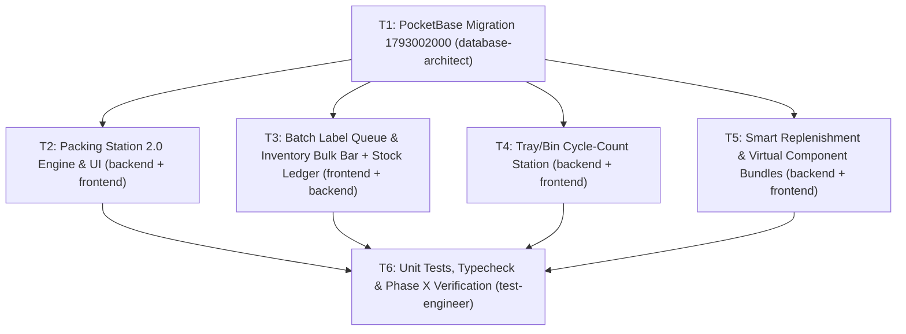

# Inventory & Packing Station 2.0 — Enhancement Master Plan

## 1. Overview

Luminila's core catalog, Quick-Add taxonomy engine, and initial Scan-Verified Packing Station (`/packing`) are operational, but daily high-velocity fashion/imitation jewelry operations expose critical workflow gaps between **receiving → tray management → cycle counting → order picking/packing → courier dispatch → restocking**:

1. **Packing Station 2.0 (`/packing`):**
   - Packers currently pick blind (`PackingLine` omits storage tray/location and product thumbnails) and have no multi-order **Wave Pick List** sorted by tray.
   - `incrementPackedItem` is strictly additive (`+1`) with no `-1` undo and no **Mid-Pack Damage/Shortage Quarantine** when a piece has a missing stone or broken clasp at the packing table (and because `channel-stock.ts` already deducts `stock_level` at order capture, flagging the last unit requires smart spare vs. short-ship handling).
   - Sidebar "Awaiting Dispatch" slip buttons pass `lines: []` (printing blank item tables), `BarcodeScanDispatchModal` hardcodes `weightGrams: 100`, and there is no **Hands-Free 2-Scan Rapid Manifest Mode** (`Scan Packing Slip` → `Scan Courier AWB`).
2. **Inventory Bulk Operations, Label Queue Handoff & Full SKU Stock Ledger (`/inventory` + `/labels`):**
   - Multi-select checkboxes in `/inventory` only open WhatsApp Broadcast. Staff cannot bulk-print barcode tags (`1 per SKU` or `1 per In-Stock Unit`), bulk-move trays, bulk-update channel pricing, or bulk-toggle publish/draft status.
   - `/labels` only accepts single-SKU URL query params (`?sku=...`), lacking a tenant-scoped batch queue from `/inventory`, `QuickReceivePOModal`, and `QuickAddProductDialog`.
   - Clicking a product in `/inventory` only shows PO history, missing a chronological **Full SKU Stock Movement Ledger** (`stock_movements`, sales, returns, discrepancies, running balance).
3. **Tray / Bin Barcode Cycle-Count & Reconciliation Station (`/inventory`):**
   - Staff can only scan 1 SKU at a time in `/inventory`. There is no **Tray Audit Station** to select a location (e.g., `Showcase Tray A`), rapid-scan all physical pieces on the tray, and reconcile **Matched**, **Missing/Shortage** (auto-quarantined to `stock_discrepancies`), **Surplus** (`audit_surplus` movement), and **Misplaced/Wrong-Tray** items (1-click move to audited tray).
4. **Smart Replenishment Queue & Virtual Combo / Bridal Set Bundles (`/inventory` + `/purchase` + `/packing`):**
   - No automated **Low-Stock & Velocity Replenishment Queue** that combines `analytics-v2/turnover.ts` (`weeksCover < 2` for fast movers) + `low_stock_threshold` (net of open POs), groups items by last supplier/cost (`vendor_products` / `purchase_order_items`), and dispatches a **1-Click Draft PO** or **Editable Vendor WhatsApp Reorder with Photos**.
   - No **Virtual Component Bundles (Bridal Sets / Combos)** where bundle availability is derived from component stock (`min(floor(component.stock / qty))`), sales deduct component SKUs, and `/packing` explodes the bundle into individual component checklist lines for piece-by-piece scan verification.

---

## 2. Project Type

- **Project Type:** **WEB** (Next.js 16 App Router + React 19 + TypeScript + Tailwind CSS v4 + Shadcn/Radix UI + PocketBase + Tauri Desktop/Android hybrid wrapper)
- **Primary Agents:** `database-architect` (P0 schema/migrations), `backend-specialist` (P1 pure engines & PocketBase services), `frontend-specialist` (P2 UI stations & modals), `test-engineer` (P3 unit/integration test scripts).

---

## 3. Architectural & Brainstorm Decisions (Locked via `/grill-me`)

| Decision Area | Chosen Architecture | Key Invariants & Guardrails |
| :--- | :--- | :--- |
| **Mid-Pack Damage / Shortage at `/packing`** | **Smart Spare Check + Short-Ship Flow** | Since `channel-stock.ts` already decrements `stock_level` on order capture: if `variant.stock_level >= 1`, quarantine 1 shelf unit via `markStockDiscrepancy` and prompt packer to scan the spare unit. If `variant.stock_level === 0` (last unit), log the discrepancy without negative stock, mark the packing line `short_damaged`, and open an **editable WhatsApp customer apology/substitution composer** (respecting `[message-templates]`). |
| **Packaging Presets & Rapid Dispatch** | **Packaging Presets + Hands-Free 2-Scan Manifest** | Select box/mailer preset during packing (sets `weightGrams` + optional packaging cost on session/shipment). Add **Rapid Manifest Mode** tab in `/packing`: Scan #1 (Packing Slip Code128) locks the packed order → Scan #2 (Courier AWB) auto-detects carrier, creates shipment with preset weight, and opens/sends tracking update. |
| **Tray / Bin Cycle-Count Reconciliation** | **Per-Bucket Reconciliation Controls + `inventory_audits`** | Live 4-bucket scan diff (`Matched`, `Missing`, `Surplus`, `Misplaced`). Committing auto-quarantines missing units (`stock_discrepancies`), increments surplus (`stock_movements` type `audit_surplus`), and applies per-item `Move to this Tray` vs `Keep Original Tray` choices, persisted in `inventory_audits`. |
| **Combo / Bridal Set Bundles** | **Virtual Component Bundle (Explodes at `/packing`)** | `bundle_items` JSON on `products`. Bundle sellable stock = `min(floor(component_stock / bundle_qty))`. Selling deducts component variants. `buildPackingLines` explodes bundle lines into component checklist rows so every piece in a bridal set is scan-verified. |
| **Smart Replenishment Queue** | **Velocity + Threshold Hybrid Grouped by Supplier** | Flags SKUs where `(stock + pending_po_qty) <= low_stock_threshold` OR `(velocity === 'fast' && weeksCover < 2)`. Resolves supplier + last unit cost from `vendor_products` / `purchase_order_items` and provides **1-Click Draft PO** + **Editable Vendor WhatsApp Reorder with Photos**. |
| **Bulk Label Printing Queue** | **Tenant-Scoped Batch Queue + PO/Quick-Add Handoff** | Multi-select in `/inventory` offers **Print 1 per SKU** or **Print 1 per In-Stock Unit**, writing to `getTenantStorageKey('luminila_label_print_queue_v1')` and routing to `/labels`. `QuickReceivePOModal` and `QuickAddProductDialog` also offer 1-click handoff of newly received/added items to `/labels`. |

---

## 4. Success Criteria

1. **Packing Station 2.0:**
   - Every `PackingLine` displays product thumbnail, storage tray badge (`location`), and remaining shelf stock.
   - **Wave Pick List** aggregates all `toPack` orders by tray (`Showcase Tray A` → `Counter 1` → etc.) and prints cleanly on A4/A5.
   - Sidebar "Awaiting Dispatch" slip button loads real order lines (zero blank item tables), and "Batch Print Slips" prints all pending slips in one job.
   - Packers can `-1` (decrement) a scanned line and execute the **Smart Spare Check + Short-Ship Flow** without negative-stock crashes.
   - **2-Scan Rapid Manifest** dispatches a packed parcel in two barcode scans (`Slip` → `AWB`) using the session's selected packaging preset weight.
2. **Inventory Bulk Actions, Label Handoff & Stock Ledger:**
   - Selecting $N$ products in `/inventory` reveals a sticky bulk bar supporting: Bulk Label Queue (`1/SKU` or `1/Stock`), Bulk Tray Move, Bulk Channel Price Update, Bulk Publish/Draft, and WhatsApp Broadcast.
   - `/labels` automatically ingests and clears `getTenantStorageKey('luminila_label_print_queue_v1')` with channel-aware pricing.
   - Clicking "Stock Ledger" on any SKU opens a chronological drawer combining `stock_movements`, PO receipts, sales, and quarantine events with running balance.
3. **Tray / Bin Barcode Cycle-Count Station:**
   - Auditing a tray classifies scans into `Matched`, `Missing`, `Surplus`, and `Misplaced`, and committing updates `stock_discrepancies`, `stock_movements`, `products.location`, and `inventory_audits` atomically under tenant isolation.
4. **Smart Replenishment & Virtual Bundles:**
   - Replenishment view groups low-stock / low-cover fast movers by vendor and creates a valid draft `PurchaseOrder` or opens an editable WhatsApp vendor reorder preview.
   - Virtual Bundles compute component-constrained availability, deduct component stock on sale, and expand into component scan lines in `buildPackingLines()`.
5. **All existing + new unit test suites pass (`npm test` & `npm run typecheck`).**

---

## 5. Tech Stack & Conventions

- **Frontend:** Next.js 16 (App Router), React 19, Lucide Icons, Tailwind CSS v4, Shadcn UI primitives (`Dialog`, `Select`, `Badge`, `DropdownMenu`, `Tabs`).
- **Database & Migrations:** PocketBase (`pocketbase/pb_migrations/`).
  - **CRITICAL TRAP GUARD (`[pocketbase-system-dates]`):** Every new programmatic PocketBase collection (`inventory_audits`) MUST explicitly declare `created` and `updated` autodate fields so `sort: '-created'` never 400s.
  - **CRITICAL ISOLATION GUARD (`[tenant-dual-layer]`):** Every PocketBase query and localStorage key must scope by `accountScopeEmail()` / `getTenantStorageKey()`.
  - **CRITICAL TEMPLATE GUARD (`[message-templates]`):** Every WhatsApp notification flow (short-ship customer outreach, vendor restock order) must provide an editable message textarea and live preview before dispatch.

---

## 6. File Structure (New & Modified Files)

```text
pocketbase/pb_migrations/
└── 1793002000_inventory_packing_v2.js          # [NEW] Adds packaging/shortage fields to order_packing, bundle_items to products, and creates inventory_audits with explicit created/updated autodate fields

src/lib/
├── packing.ts                                  # [MOD] Enrich PackingLine (location, image, stock), decrementPackedItem, flagMidPackDamage, packaging presets, bundle line explosion, wave pick aggregation
├── label-queue.ts                              # [NEW] Tenant-scoped batch label print queue helper (push/consume/clear for /inventory, PO receive, Quick Add -> /labels)
├── cycle-count.ts                              # [NEW] Pure diff engine (Matched/Missing/Surplus/Misplaced) + PocketBase commit service for inventory_audits
├── stock-ledger.ts                             # [NEW] Unified chronological SKU stock movement & audit trail aggregator
├── replenishment.ts                            # [NEW] Velocity + threshold low-stock engine grouped by supplier with 1-click Draft PO & vendor WhatsApp builder
├── bundles.ts                                  # [NEW] Virtual component bundle availability math, component stock deduction, and packing line explosion
├── channel-stock.ts                            # [MOD] Support virtual bundle component deduction when a bundle SKU is sold
└── products.ts                                 # [MOD] Bulk update helpers (bulkMoveLocation, bulkUpdatePricing, bulkToggleActive) + bundle_items typing

src/components/packing/
├── PackingSlip.tsx                             # [MOD] Support batch multi-slip printing + lazy line loading when lines are omitted + tray location column
├── WavePickListModal.tsx                       # [NEW] Consolidated multi-order Wave Pick List grouped by Tray/Location with print view
├── MidPackDamageModal.tsx                      # [NEW] Smart Spare Check vs Short-Ship modal with editable WhatsApp customer substitution/apology preview
└── RapidManifestPanel.tsx                      # [NEW] Hands-Free 2-Scan Conveyor Mode (Scan Packing Slip -> Scan Courier AWB -> Auto-Dispatch)

src/components/inventory/
├── InventoryBulkActionBar.tsx                  # [NEW] Sticky bottom bulk bar (Print Labels 1/SKU or 1/Stock, Move Tray, Bulk Price, Publish/Draft, WA Broadcast)
├── TrayCycleCountModal.tsx                     # [NEW] Barcode cycle-count station per Tray/Location with 4-bucket diff & 1-click reconciliation
├── ProductStockLedgerModal.tsx                 # [NEW] Full chronological SKU movement ledger drawer/modal
├── SmartReplenishmentModal.tsx                 # [NEW] Low-stock & fast-mover restock queue grouped by vendor -> 1-click Draft PO or editable WA Vendor Order
├── BundleComposerSection.tsx                   # [NEW] Component SKU picker inside Product form for Virtual Bridal Sets / Combos
├── QuickReceivePOModal.tsx                     # [MOD] Add 1-click "Print Labels for Received Batch" handoff via label-queue.ts
└── QuickAddProductDialog.tsx                   # [MOD] Add "Print Session Labels" handoff button for pieces added in current series session

src/app/
├── packing/page.tsx                            # [MOD] Integrate thumbnails, tray badges, -1 undo, MidPackDamageModal, Packaging Presets, WavePickListModal, RapidManifestPanel, and fix sidebar slip lines
├── inventory/page.tsx                          # [MOD] Integrate InventoryBulkActionBar, TrayCycleCountModal, ProductStockLedgerModal, SmartReplenishmentModal, and Bundle badge/editor
└── labels/page.tsx                             # [MOD] Consume batch items from label-queue.ts on mount with toast summary

src/scripts/
├── test-packing.ts                             # [MOD] Add unit tests for decrementPackedItem, bundle explosion, wave pick grouping, and mid-pack damage state transitions
├── test-cycle-count.ts                         # [NEW] Pure unit tests for 4-bucket tray audit reconciliation math
└── test-bundles-replenishment.ts               # [NEW] Pure unit tests for virtual bundle stock math and replenishment supplier grouping
```

---

## 7. Task Breakdown & Dependency Graph



### Phase 1: Foundation & Packing Station 2.0

#### `T1` — PocketBase Schema Migration (`1793002000_inventory_packing_v2.js`)
- **Agent:** `database-architect` | **Skills:** `database-design`, `clean-code` | **Priority:** P0 | **Dependencies:** None
- **INPUT:** Existing `order_packing`, `products`, and `shipments` collections in `pocketbase/pb_migrations/`.
- **OUTPUT:** Migration `pocketbase/pb_migrations/1793002000_inventory_packing_v2.js` adding:
  1. `order_packing`: `packaging_preset` (text), `weight_grams` (number), `packaging_cost` (number), `shortage_items` (json).
  2. `products`: ` is_bundle` (bool), `bundle_items` (json array of `{variant_id, product_id, sku, name, quantity}`).
  3. `inventory_audits`: new collection with `account_email`, `location`, `category`, `status`, `scanned_items` (json), `summary` (json), `audited_by`, and **explicit `created` / `updated` autodate fields** + strict `account_email` API rules.
- **VERIFY:** PocketBase applies migration cleanly on startup; `sort=-created` on `inventory_audits` returns 200 OK.

#### `T2` — Packing Station 2.0 (`/packing`, Wave Pick, Mid-Pack Quarantine, Packaging Presets & 2-Scan Manifest)
- **Agent:** `backend-specialist` + `frontend-specialist` | **Skills:** `frontend-architecture`, `clean-code` | **Priority:** P1 | **Dependencies:** `T1`
- **INPUT:** [`src/lib/packing.ts`](file:///e:/Local_GIT_2/luminila_inv_mgmt/src/lib/packing.ts), [`src/app/packing/page.tsx`](file:///e:/Local_GIT_2/luminila_inv_mgmt/src/app/packing/page.tsx), [`src/components/packing/PackingSlip.tsx`](file:///e:/Local_GIT_2/luminila_inv_mgmt/src/components/packing/PackingSlip.tsx).
- **OUTPUT:**
  - Enrich `PackingLine` with `location`, `image_url`, `stock_level`, and `bundle_parent_sku`.
  - Add `decrementPackedItem()` (`-1` undo button per line) and `buildWavePickList()` grouped by storage tray.
  - Create `MidPackDamageModal.tsx` implementing the **Smart Spare Check (`stock_level >= 1`) vs. Short-Ship (`stock_level === 0`)** workflow with editable WhatsApp customer preview.
  - Add Packaging Presets (`Velvet Box 80g`, `Rigid Bridal Box 250g`, `Bubble Pouch 40g`, `Custom`) on `/packing` and pass `weightGrams` to `createShipmentForOrder`.
  - Fix sidebar `PackingSlipButton` to lazy-fetch order lines when `lines` is empty, and add **Batch Print All Pending Slips**.
  - Create `RapidManifestPanel.tsx` for hands-free `Scan Slip` → `Scan AWB` conveyor dispatch.
- **VERIFY:** `npx tsx src/scripts/test-packing.ts` passes; `/packing` renders tray badges, thumbnails, `-1` undo, Wave Pick print, and 2-scan dispatch.

---

### Phase 2: Inventory Bulk Operations, Label Queue Handoff & SKU Stock Ledger

#### `T3` — Multi-Select Bulk Action Bar, Batch Label Queue & SKU Stock Ledger Drawer
- **Agent:** `frontend-specialist` + `backend-specialist` | **Skills:** `frontend-architecture`, `clean-code` | **Priority:** P1 | **Dependencies:** `T1`
- **INPUT:** [`src/app/inventory/page.tsx`](file:///e:/Local_GIT_2/luminila_inv_mgmt/src/app/inventory/page.tsx), [`src/app/labels/page.tsx`](file:///e:/Local_GIT_2/luminila_inv_mgmt/src/app/labels/page.tsx), [`src/components/inventory/QuickReceivePOModal.tsx`](file:///e:/Local_GIT_2/luminila_inv_mgmt/src/components/inventory/QuickReceivePOModal.tsx), [`src/components/inventory/QuickAddProductDialog.tsx`](file:///e:/Local_GIT_2/luminila_inv_mgmt/src/components/inventory/QuickAddProductDialog.tsx).
- **OUTPUT:**
  - `src/lib/label-queue.ts`: Tenant-scoped queue (`luminila_label_print_queue_v1_<email>`) supporting `1 per SKU` or `1 per In-Stock Unit`.
  - Update `/labels` to ingest queued items on mount and show a summary toast.
  - Add 1-click "Send Batch to Label Printer" buttons in `QuickReceivePOModal` (after PO inward) and `QuickAddProductDialog`.
  - `InventoryBulkActionBar.tsx`: Sticky bar when `selectedProductIds.length > 0` with Bulk Print Labels, Bulk Move Tray/Location, Bulk Price/Channel Override Adjust, Bulk Publish/Draft toggle, and WhatsApp Broadcast.
  - `src/lib/stock-ledger.ts` + `ProductStockLedgerModal.tsx`: Unified chronological timeline of all `stock_movements`, sales, returns, PO receipts, and quarantine flags for any SKU with running balance.
- **VERIFY:** Selecting multiple items in `/inventory` performs bulk tray moves, bulk price updates, and populates `/labels` with exact stock quantities.

---

### Phase 3: Tray / Bin Barcode Cycle-Count & Reconciliation Station

#### `T4` — Tray Cycle-Count Engine & Audit Modal (`cycle-count.ts` + `TrayCycleCountModal.tsx`)
- **Agent:** `backend-specialist` + `frontend-specialist` | **Skills:** `clean-code`, `frontend-architecture` | **Priority:** P1 | **Dependencies:** `T1`
- **INPUT:** [`src/lib/discrepancies.ts`](file:///e:/Local_GIT_2/luminila_inv_mgmt/src/lib/discrepancies.ts), [`src/lib/products.ts`](file:///e:/Local_GIT_2/luminila_inv_mgmt/src/lib/products.ts).
- **OUTPUT:**
  - `src/lib/cycle-count.ts`: Pure `computeTrayAuditDiff(expectedItems, scannedCounts, targetLocation)` classifying every SKU into `matched`, `missing` (`scanned < expected`), `surplus` (`scanned > expected`), and `misplaced` (`item.location !== targetLocation`).
  - Commit function `commitTrayAudit()` that:
    1. Flags `missing` units into `stock_discrepancies` (`discrepancy_type: 'missing'`).
    2. Increments `surplus` units on `product_variants` with a `stock_movements` row (`movement_type: 'audit_surplus'`).
    3. Reassigns `product.location = targetLocation` for misplaced items marked "Move to this Tray".
    4. Saves the audit record in `inventory_audits`.
  - `TrayCycleCountModal.tsx`: Hardware barcode gun + camera scanner interface with live progress bar, 4-bucket tabs, per-item reconciliation toggles, and past audit history log.
- **VERIFY:** `npx tsx src/scripts/test-cycle-count.ts` passes all 4 bucket math invariants and edge cases.

---

### Phase 4: Smart Replenishment Queue & Virtual Component Bundles

#### `T5` — Smart Replenishment Queue & Virtual Bridal Set / Combo Bundles
- **Agent:** `backend-specialist` + `frontend-specialist` | **Skills:** `clean-code`, `frontend-architecture` | **Priority:** P2 | **Dependencies:** `T1`, `T2`
- **INPUT:** [`src/lib/analytics-v2/turnover.ts`](file:///e:/Local_GIT_2/luminila_inv_mgmt/src/lib/analytics-v2/turnover.ts), [`src/lib/purchase.ts`](file:///e:/Local_GIT_2/luminila_inv_mgmt/src/lib/purchase.ts), [`src/lib/vendors.ts`](file:///e:/Local_GIT_2/luminila_inv_mgmt/src/lib/vendors.ts), [`src/lib/channel-stock.ts`](file:///e:/Local_GIT_2/luminila_inv_mgmt/src/lib/channel-stock.ts).
- **OUTPUT:**
  - `src/lib/replenishment.ts` + `SmartReplenishmentModal.tsx`: Identifies SKUs where `(stock + pending_po) <= low_stock_threshold` or `(velocity === 'fast' && weeksCover < 2)`, matches each to its last vendor & unit cost, groups by supplier, and provides **1-Click Create Draft PO** + **Editable Vendor WhatsApp Reorder Composer (with product thumbnails)**.
  - `src/lib/bundles.ts` + `BundleComposerSection.tsx`: Allows defining a product as a Virtual Bundle of component variants; computes effective bundle stock `min(floor(component.stock / qty))`; deducts component variants in `channel-stock.ts` on sale; explodes bundle lines into component scan lines in `buildPackingLines()`.
- **VERIFY:** `npx tsx src/scripts/test-bundles-replenishment.ts` passes; selling a bundle deducts component stock and `/packing` requires scanning each component piece.

---

## 8. Phase X: Final Verification Checklist

- [ ] Dedicated feature branch created (`feat/inventory-packing-v2`) per project conventions
- [ ] All new PocketBase migrations include explicit `created` and `updated` autodate fields
- [ ] Dual-layer tenant isolation (`account_email` filter + in-memory check + `getTenantStorageKey`) verified across all new queries and storage keys
- [ ] WhatsApp outreach modals provide direct message editing and live preview before dispatch (zero canned auto-send)
- [ ] Unit test suites pass: `npx tsx src/scripts/test-packing.ts`, `npx tsx src/scripts/test-cycle-count.ts`, `npx tsx src/scripts/test-bundles-replenishment.ts`
- [ ] Full TypeScript validation passes: `npm run typecheck`
- [ ] Production build succeeds: `npm run build`
